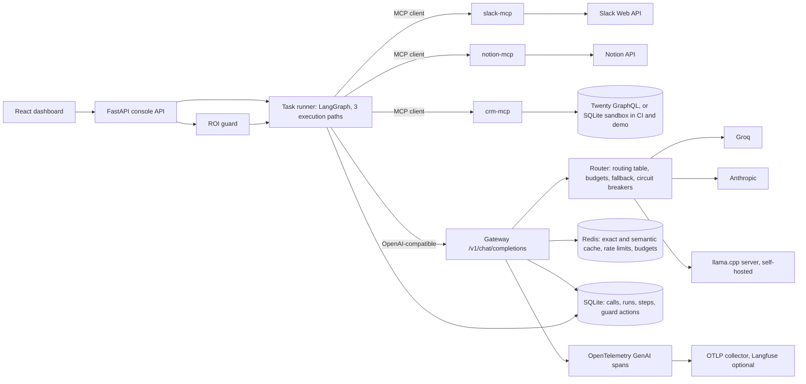

# Agent ROI Console

**Public demo:** https://tirthborasaniya.github.io/agent-roi-console/ (a read-only static snapshot of real evaluation results, published by `.github/workflows/pages.yml` once the results files are committed; it is not published yet).

Teams adopt AI workflow automations without knowing whether each one pays for itself. The Agent ROI Console runs four operational workflows against real tools (Slack and Notion through their APIs and a self-hosted Twenty CRM, each exposed as an MCP server), measures task success with deterministic validators that check real end state, routes every model call through an OpenAI-compatible gateway that picks the cheapest model meeting each step's measured success bar, and computes ROI from measured success and measured cost, including the human time to review outputs and fix failures. When a workflow's rolling ROI turns negative, a guard switches it to a cheaper execution path and, if that does not help, pauses it and alerts Slack.

## Headline results

All numbers below are rendered by `make results` from `results/*.json`; nothing in this file is typed by hand.

<!-- results:headline:start -->
_No results yet. Phase 2 runs `make eval`; until then this table is empty by design._
<!-- results:headline:end -->

## Architecture



| Component | Code | Role |
|---|---|---|
| Workflow definitions | `configs/workflows/*.yaml`, `backend/src/roiconsole/workflows/` | Declarative steps, prompts, human-time assumptions, validators |
| Execution paths | `backend/src/roiconsole/paths/` | `pipeline` (declared steps), `planner_executor` (JSON plan then execution), `react` (agent loop) |
| Task runner | `backend/src/roiconsole/runner/` | Reset workspace, run a path, snapshot end state, validate, persist |
| MCP servers | `backend/src/roiconsole/mcp_servers/` | `slack-mcp`, `notion-mcp`, `crm-mcp` (FastMCP, stdio or streamable HTTP) |
| Gateway | `backend/src/roiconsole/gateway/` | Routing, budgets, retries, breakers, caches, rate limits, telemetry, cost attribution |
| ROI and guard | `backend/src/roiconsole/roi/`, `backend/src/roiconsole/guard/` | SPEC 6 ROI, sensitivity, break-even, downgrade and pause |
| Evaluation | `backend/src/roiconsole/evaluation/`, `eval/` | 60-task suite and experiments E1 to E5 |
| Dashboard | `frontend/` | Overview, Workflow detail, Gateway, Guard log |

## Quickstart

```bash
make setup && make up && make demo
```

`make setup` installs the pinned Python 3.11 environment (uv) and the frontend packages. `make up` starts Redis, the OTLP collector, the three MCP servers, the gateway, and the console API with the dashboard at http://127.0.0.1:8000; with no keys in `.env` everything runs in demo mode on fixtures. `make demo` builds the read-only demo from the committed results and serves it at http://127.0.0.1:4173. The CRM and self-hosted model are compose profiles: `make up-crm`, `make up-selfhosted`, or `make up-full`. See `docs/runbook.md` for keys, seeding, and evaluation runs.

## How it works

### Workflows and execution paths

The four workflows of the original console are kept and defined in YAML: Slack Channel Digest, Notion Knowledge Search, Meeting Notes to Notion, and CRM Pipeline Summary. Each runs on three paths: the deterministic `pipeline` executes the declared steps and calls a model only at declared LLM steps; `planner_executor` asks a model for a JSON plan of tool calls and generation steps and executes it; `react` is an agent loop over the workflow's MCP tools. A run succeeds only when its path completes and every validator passes on the real end state (a message in the right channel or thread with required terms, a Notion page with required properties and to-dos, a CRM activity on the right contact).

### Connectors as MCP servers

Each connector is its own FastMCP server. Write tools take an idempotency key (a hash of run id, step id, and arguments) and return the first result on repeats. Channels and databases are allowlisted in `configs/connectors.yaml`, writes are throttled to stay inside provider rate limits, and every call is logged with run and step ids. In live mode the servers call Slack, Notion (API version 2025-09-03, data sources), and a self-hosted Twenty instance; in dry-run and demo mode they use a shared SQLite sandbox.

### Gateway

`POST /v1/chat/completions` takes OpenAI requests with attribution metadata. For `model: auto`, the router picks the cheapest candidate whose measured step success (from E1) meets the step class bar and falls back through the other qualifying candidates. Per-run and per-workflow-per-day budgets downgrade or halt a run with `budget_exhausted`. Each provider has a 30 s timeout, two jittered retries, and a circuit breaker (opens after 5 failures in 60 s, half-opens after 30 s). An exact cache serves identical requests; a RedisVL semantic cache serves only step classes marked `cacheable` (extraction and classification, never drafting). Every call emits a `chat {model}` OpenTelemetry span and Prometheus metrics and is recorded with its cost. The self-hosted price is computed from measured throughput: `host_hour_usd / 3600 / tokens_per_second * 1e6`.

### ROI and the guard

Per task, `value = success * minutes_per_task / 60 * labor_rate`, `human_cost = (review_minutes + (1 - success) * fix_minutes) / 60 * labor_rate`, `cost = llm_cost + tool_cost + human_cost`, and `net = value - cost`. The console reports ROI ratio, cost per successful task, the break-even success rate, break-even minutes per task, and a sensitivity grid over 25 to 150 percent of the baseline minutes at 25, 55, and 100 USD per hour. The guard evaluates every 15 minutes; a workflow with at least 20 production runs and negative net ROI is switched to its cheapest path meeting the success bar, and paused with a Slack alert if ROI is still negative over the next 20 runs.

### Dashboard

The dashboard reads every number from the API. The static demo uses the same pages with a snapshot exported from results files.

## Evaluation

Protocol: 60 tasks (15 per workflow) with fixed fixtures, generated by `scripts/generate_task_suite.py` and split by hashed task id into 20 development and 40 held-out tasks before any prompt work (`eval/splits.yaml`). The workspace is reset before every run. Rates carry Wilson 95 percent intervals. Long runs checkpoint to `eval/checkpoints/` and resume. Gateway caching is off during evaluations.

| Id | Reproduce | Output |
|---|---|---|
| E1 | `make eval-steps` (also writes `configs/routing_table.yaml`) | `results/e1_step_success.json` |
| E2 | `make eval-tasks` | `results/e2_tasks.json` |
| E3 | `make eval-roi` | `results/e3_roi.json` |
| E4 | `make eval-gateway` | `results/e4_gateway.json` |
| E5 | `make eval-guard` | `results/e5_guard.json` |
| Self-hosted price | `make measure-selfhosted` | `results/selfhosted_throughput.json` |
| Live connectors | `make live-tasks` | `results/live_tasks.json` |
| Inventory | `make inventory` | `results/inventory.json` |

### E1: step success per step class and model (development split)

<!-- results:e1:start -->
_Not produced yet: `results/e1_step_success.json` is written by `make eval-steps`._
<!-- results:e1:end -->

### E2: held-out tasks per path and model configuration

<!-- results:e2:start -->
_Not produced yet: `results/e2_tasks.json` is written by `make eval-tasks`._
<!-- results:e2:end -->

### E3: ROI per workflow and path (routed configuration)

<!-- results:e3:start -->
_Not produced yet: `results/e3_roi.json` is written by `make eval-roi`._
<!-- results:e3:end -->

### E4: gateway under failure

<!-- results:e4:start -->
_Not produced yet: `results/e4_gateway.json` is written by `make eval-gateway`._
<!-- results:e4:end -->

### E5: ROI guard on simulated streams

<!-- results:e5:start -->
_Not produced yet: `results/e5_guard.json` is written by `make eval-guard`._
<!-- results:e5:end -->

### Inventory

<!-- results:inventory:start -->
_Not produced yet: `results/inventory.json` is written by `make inventory`._
<!-- results:inventory:end -->

## Design decisions

See `DECISIONS.md`. The main ones: workflows run as YAML-declared steps so the pipeline path calls a model only where judgment is needed (D-001); validators read real end state through the connector backends, never the agent's report (D-002); the gateway is a separate OpenAI-compatible service so every model call is routed, budgeted, and attributed in one place (D-005); the routing table is generated from measured step success, not chosen by hand (D-006); the self-hosted price is computed from measured throughput (D-009); and ROI includes review and fix time so failures cost money (D-010).

## Limitations

- Human baselines are assumptions. No workflow has been timed yet (`docs/baselines.md`); every ROI figure depends on them, which is why the sensitivity grid and break-even minutes are reported next to it.
- Two of the SPEC's Groq models (`llama-3.1-8b-instant`, `llama-3.3-70b-versatile`) were shut down on 2026-08-16 and are replaced by `openai/gpt-oss-20b` (fast roles) and `openai/gpt-oss-120b` (strong roles), alongside `anthropic/claude-haiku-5-5` (D-012).
- E1 measures each step class on 5 to 10 development tasks per model, so routing decisions rest on wide intervals.
- The task suite is generated from templates. It tests whether outputs carry the required facts, decisions, and records, not prose quality.
- The self-hosted model is the public Qwen2.5-1.5B-Instruct Q4_K_M until the distilled student from Spec 06 is published; results name the model served.
- The pre-call cost estimate uses `max_tokens`, so budget downgrades are conservative.
- Deflection rate is not measured and not claimed.
- The guard acts on production runs only; evaluation runs are excluded from its windows.

## Repository layout

```
backend/src/roiconsole/
  api/ runner/ paths/ workflows/ validators/ guard/ roi/ sandbox/ selfhosted/ evaluation/
  gateway/ (adapters/, router.py, budgets.py, cache.py, breaker.py, pricing.py, telemetry.py, ...)
  mcp_servers/ (slack_server.py, notion_server.py, crm_server.py, backends/)
  common/ (settings.py, db.py, metrics.py, logging.py, results.py, config.py, ids.py)
frontend/src/  pages/ components/ api/
configs/  workflows/ eval/ pricing.yaml budgets.yaml gateway.yaml connectors.yaml step_classes.yaml ...
eval/  tasks/ splits.yaml gateway/ baselines/
results/  tests/ (unit, integration, live)  scripts/  docs/
```
